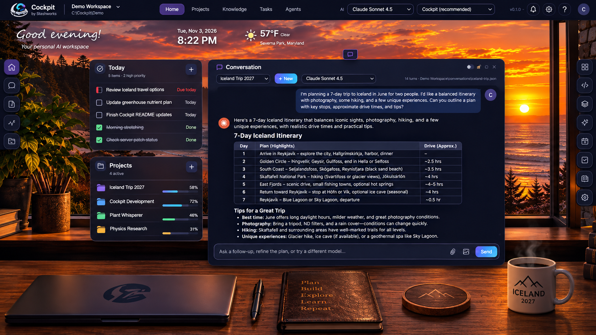

# Cockpit

### Your files. Your AI. Your workspace.

**A local-first personal AI assistant that works with your files, remembers your conversations, and lets you use the AI models you choose.**

Cockpit brings your projects, documents, research, and AI conversations together in one workspace, without requiring you to move your files into another platform or surrender control of your data.

Connect an existing folder, choose an AI model, and get to work. Plan a vacation, organize research, explore ideas, manage projects, or build software. Cockpit works with the files you already have, keeping your conversations and AI-generated content on your own computer.
You decide which models to use and what information they can access.

**Switch AI models without starting over.** Begin a conversation with one model, switch to another halfway through, and continue where you left off. Your conversation history belongs to Cockpit, not to any particular AI provider.

**Work online or completely offline.** Connect to cloud AI providers when you want their capabilities, or use local models to work without an internet connection. You decide which models to use and what information they can access.



## Why Cockpit?

- **Your data stays yours.** Files, conversations, and project history are stored locally in accessible files, not locked inside a proprietary cloud workspace.
- **Any AI, one conversation.** Switch between supported AI models without losing your conversation history or starting over.
- **Your existing folders become workspaces.** Organize and work with documents, notes, research, code, and projects without importing everything into a new system.
- **More than a chatbot.** Work with AI across your projects and files, with tools and capabilities that go beyond answering questions.
- **Built for everyone.** Whether you're a hobbyist, researcher, writer, vibe coder, or someone organizing everyday life, Cockpit adapts to what you're working on.
- **Local-first by design.** Work with local AI models entirely offline, or connect to cloud models when you choose.

## One workspace. Endless possibilities.

**Personal assistant:** Organize your plans, projects, documents, and everyday activities.

**Research and learning:** Explore ideas, work through complex problems, and maintain context across your notes and conversations.

**Planning and organization:** Plan vacations, organize household projects, and bring scattered information together.

**Software development:** Work with AI coding agents, inspect architecture, manage repositories, and build software with greater visibility and control.

Cockpit isn't tied to one profession, one workflow, or one AI provider.

**It's your workspace. You decide what to do with it.**

## Requirements

- **Windows:** No separate Node.js installation required. Cockpit downloads a private Node.js 24 runtime when needed.
- **Git:** Optional for general use; recommended for software development.
- **AI:** At least one supported AI provider or local model must be configured. The setup wizard helps you get started.
  Download and install first. Logged in as the user that runs Cockpit:
  - [Claude Code](https://docs.anthropic.com/en/docs/claude-code) (`claude`), and/or
  - [Codex CLI](https://github.com/openai/codex) (`codex`), and/or
  - Pi (the `pi` coding-agent CLI) with [Ollama](https://ollama.com) for local models.
- Optional: the [GitHub CLI](https://cli.github.com) (`gh`, logged in) for the GitHub plugin; MySQL's
  `mysql` client for the Database plugin.

Cockpit has been developed and used on Windows. Most of it is plain Node and should run elsewhere,
but other platforms are untested.

## Quick start on Windows

1. Copy this folder anywhere (for example `C:\Tools\Cockpit`).
2. Double-click **`Start Cockpit.cmd`**. That's all. The first time:
   - if this PC has no Node.js 24, a small window downloads a private copy into `runtime\` (nothing installed on
     Windows) and closes itself;
   - Cockpit starts **in the background** - no window to keep open - and your browser opens at
     <http://localhost:47821>;
   - **the setup wizard** walks you through the rest, one screen at a time: your name, where Cockpit runs (the port,
     and starting automatically when you sign in - on by default), Git, Claude Code (installed? signed in? - each with an Install or Sign in button,
     ticking itself when done), your Home, your first folder, and a one-minute tour of the screen.
3. After that there is nothing to click. **Cockpit starts by itself when you sign in to Windows** and keeps running in
   the background; just open <http://localhost:47821> (bookmark it). `Start Cockpit.cmd` still works any time - it starts
   Cockpit if it is not running and opens the browser. **Stop it** from Settings → Engine → Stop Cockpit, or with
   `Stop Cockpit.cmd`.

### Staying on, and coming back after a restart

- **"Start Cockpit automatically when I sign in"** is on by default (the setup wizard's "Where Cockpit lives" screen, and
  Settings → Engine, where you can switch it off). It is a **Scheduled Task for your Windows user only**, named
  `\Cockpit\Cockpit` in Task Scheduler, run when you sign in, hidden. It is not a Windows service and needs no
  administrator. On a PC where Windows refuses the task, a shortcut in your Startup folder does the same job. An older
  Startup-folder shortcut from a previous version is replaced by the task.
- **A watchdog keeps it running.** What runs is `scripts\start.ps1 -Watch`: a small PowerShell loop with no window that
  starts the engine (with no console window of its own, so there is nothing to close by mistake) and, if the engine ever
  ends on its own - a crash - starts it again after a few seconds (slower if it keeps failing straight away). What it
  does goes to `logs\watchdog.log`; why the engine ended goes to `logs\crash.log`. `Start Cockpit.cmd` starts the same
  watchdog; there is only ever one per Cockpit folder.
- **Stop stays stopped.** Stopping (Settings or `Stop Cockpit.cmd`) leaves a file `run\stopped`; the watchdog sees it and
  does not start Cockpit again. `Start Cockpit.cmd`, or your next sign-in to Windows, clears it.
- Why it used to stop: it only ran when `Start Cockpit.cmd` was clicked (starting with Windows was an unticked box),
  nothing restarted it after an error, and on PCs where Windows Terminal is the default terminal its "hidden" console
  could appear as a window that ended Cockpit when closed.
- To check it: Task Scheduler → Task Scheduler Library → Cockpit. To remove it by hand:
  `schtasks /Delete /TN \Cockpit\Cockpit /F`.

Settings → Engine runs the wizard or the tour again. What the engine prints goes to `logs\engine.log`. If your PC is
managed by an IT team, check with them before installing software. The two `.cmd` files are all you click; what they
run lives in `scripts\`.

Already have Claude Code? The wizard finds it, including one installed before Cockpit, in a folder Windows only adds to
the PATH at your next sign-in.

## Install and run

```
git clone https://github.com/stashworks/cockpit.git
cd cockpit
npm install          # one dependency: playwright, used only for browser checks
node index.js        # or: npm start
```

Then open <http://localhost:47821>; the setup wizard opens the first time. **Home's conversation also shows a "Getting
started" checklist** on a new conversation: what this machine still needs, in the order to install it, each step checked
live (Node, git, Claude Code installed and signed in, your first project, then the optional extras). It is about the
machine, so it shows only in Home's own conversation, never in other projects. Once everything required is there, or you
press "Don't show this again", it is gone for good (engine.json `setupHidden`); Settings → Engine → "Show the Getting
started list" brings it back. The same list is at `GET /api/setup`.

- **The port** is 47821 (out of the way of the ports dev tools use; taken anyway, Cockpit moves up to the next free one). Change it in the setup wizard, with the `COCKPIT_PORT` environment variable (or `PORT`), or with
  `"port"` in an `engine.json` file beside `index.js`:
  ```
  COCKPIT_PORT=4900 node index.js
  ```
- **There is no login.** By default the engine listens on this machine only (`127.0.0.1`). To
  open it to other machines, set `COCKPIT_HOST=0.0.0.0` (or `"host"` in `engine.json`): anyone who
  can reach the port can then use it, so only do that on a network you trust.
- **Local HTTPS sites:** if your test sites use a local certificate authority (Caddy `tls internal`,
  mkcert), point `COCKPIT_EXTRA_CA` at its root certificate. Cockpit trusts it in addition to the
  normal ones; certificate checks stay on.
- Browser checks need Chromium for Playwright; `node tools/fetch.js --unpack` downloads it (and
  OWASP ZAP and a Java runtime for DAST) into this folder, not into the system.

## Adding a project

1. Click the project switcher (top left), then open a folder: type or paste its path, e.g.
   `C:\projects\my-app`. Cockpit registers it, creates `my-app\.cockpit\`, and opens its control room.
   The project's id (and its URL, `/my-app`) is the folder name.
2. Talk to it. While `.cockpit\project.md` is still the empty stub, the AI follows
   `prompts/new-project.md`: it asks one plain question, what you want to use the project for, and
   goes from there. Notes, plans and reminders need no setup at all. A beginner's app gets safe defaults,
   and the full developer setup (dev and prod, GitHub, site names) is offered only to those who want it.
3. Turn plugins on from the project's Plugins page (Architecture, Coding, Tickets, GitHub,
   Database); each asks its own short set of questions. These are all behind the **Coding** switch (below).

**Coding is a plugin, and it is off by default.** Everything about writing software - the agent fleet and its queue, Lane
performance, Alerts and the Event log, Backups, Data views, and the project plugins for code (Architecture, Coding with its
Tests tab, Tickets with the board, pipeline and deploys, GitHub, Database) - sits behind one switch at the top of
Settings → Plugins and cards. Off, none of it appears anywhere: not on Home, not in a drawer, not in ＋ Card or the card
lists, and the code map is not read in the background. On, it all comes back, each card where it was (a card a desk has
never seen arrives in its Home drawer, or switched off but listed). The switch is engine-wide (engine.json `coding`, or
`COCKPIT_CODING=1`). A card joins the group with `coding: true`; a plugin with `"group": "coding"` in its plugin.json.

**A new desk starts quiet.** On a first install, and for every project created after that, only the **Conversation**
and **Notes** cards are on (and on Home, the greeting). Every other card is off and one switch away in Settings → Plugins
and cards (or ＋ Card). A desk you have already arranged is never changed. A "Default Project Layout" scene saved on Home,
if you made one, is still what new projects start from.

**Home** is the front door: create a folder named `home` (for example `C:\projects\home`) and open
it like any other project. Home's desk can hold cards from every project, and Home's AI is your
assistant across all of them.

## Configuration

Every setting has a default, so Cockpit runs with no configuration at all. Engine settings go in
`engine.json` beside `index.js` (not committed) or in environment variables, which win over the
file. Per-project settings live in that project's `.cockpit\` folder and are set through the
Plugins page.

| Setting | `engine.json` key | Environment variable | Default |
| --- | --- | --- | --- |
| Port | `port` | `COCKPIT_PORT` (or `PORT`) | `47821` |
| Listen address | `host` | `COCKPIT_HOST` | `127.0.0.1` (this machine only; `0.0.0.0` = the network, no login) |
| Extra trusted root certificates (local HTTPS sites) | `extraCa` | `COCKPIT_EXTRA_CA` | none |
| Minutes before an unwatched project goes quiet | `idleUnloadMinutes` | - | `10` |
| Whose layouts, and the name Home greets | `person` | `COCKPIT_PERSON` | `default` (greets "there") |
| Folder for secrets kept outside every repo | `secretsDir` | `COCKPIT_SECRETS_DIR` | `config` two folders above the engine |
| Projects allowed their own sealed "boxed" cards | `boxedCards` | `COCKPIT_BOXED_CARDS` (comma-separated) | none |
| Source of Home's greeting lines | `missionSource` | `COCKPIT_MISSION_SOURCE` | none (built-in quotes) |
| An outside backup job's status file to watch | `externalBackupStatus` | `COCKPIT_EXTERNAL_BACKUP_STATUS` | none (not watched) |

The full list, including the variables Cockpit sets for its own child processes and the per-project
files, is in [CONFIGURATION.md](CONFIGURATION.md).

## Tests

The tests use Node's own runner and need no install except where noted:

```
node test/scope.js            # and so on, one file at a time
```

`test/m1-*.js` to `test/m4-*.js` and `test/architecture-views.js` run against a live engine
(`COCKPIT_URL`, default `http://localhost:4500`); `m2`-`m4` spend real AI turns.

## State of the project

Cockpit is an early-stage project in active development and daily use.
It supports personal organization, research, planning, and AI-assisted
software development.

The application is currently Windows-first. Other platforms have not
been fully tested. Expect occasional rough edges, evolving features,
and changes to the interface.

Feedback, bug reports, and ideas are welcome. There is no stable API yet.

## Privacy and data ownership

Cockpit stores conversations, project information, and AI-generated
files locally on your computer.

When using a local AI model, processing can take place entirely offline.

When using a cloud AI provider, relevant conversation content and
any files shared with that model may be transmitted to the provider
for processing.

Your files remain under your control, and you choose which AI
providers to use.

## License

Cockpit is free and open source under the [GNU Affero General Public License v3.0](LICENSE) (AGPL-3.0), and is also
available under a commercial license.

- **Using it is free, for anyone:** at home, at work, for any purpose, at no cost. Running it on your own computer,
  changed or not, asks nothing more of you.
- **If you change it and offer it to other people over a network** (a hosted service, for example), the AGPL asks you to
  make your changed source code available to those people under the same license.
- **A commercial license** is for organizations that want to keep their changes private, build Cockpit into a closed
  product, or cannot use AGPL software. See [COMMERCIAL-LICENSE.md](COMMERCIAL-LICENSE.md).

Contributions are welcome under the terms in [CONTRIBUTING.md](CONTRIBUTING.md).

Copyright 2026 Dave Roberts
